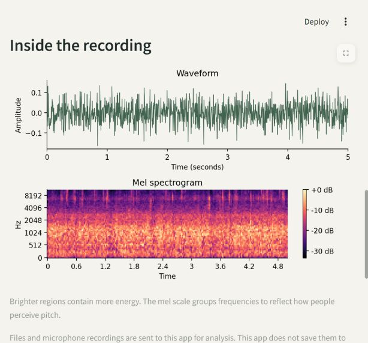

# SoundSight 🎧 · ESC-50 Sound Classifier

Hear a sound. See its likely source and the frequency patterns behind the prediction.

[](https://soundsight-ran-nope.streamlit.app/)
[](https://github.com/ran-nope/SoundSight/actions/workflows/tests.yml)


[**Try the live demo →**](https://soundsight-ran-nope.streamlit.app/) Record through your microphone, choose a dog, rain or clock sample, or upload MP3, WAV, FLAC, OGG or AIFF. Free hosting may need a minute to wake up.



## Run locally

With Python 3.12 in an activated virtual environment, from the repository root:

```bash
git clone https://github.com/ran-nope/SoundSight.git && cd SoundSight
python -m pip install -r requirements.txt
streamlit run app.py
```

The fitted model and three attributed samples are included; no dataset download or retraining is required to try the app. Run `python -m pytest -q` for software checks.

## Measured baseline

An actual RBF SVM trained on 218 acoustic features. Results use five held-out folds, excluding training clips that share a source recording with the current test fold.

| Held-out fold | Accuracy | Macro F1 |
| --- | ---: | ---: |
| 1 | 56.75% | 0.5589 |
| 2 | 58.50% | 0.5671 |
| 3 | 54.00% | 0.5281 |
| 4 | 61.25% | 0.6014 |
| 5 | 57.25% | 0.5576 |
| **Mean** | **57.55%** | **0.5626** |

This stricter source-isolation protocol differs slightly from standard ESC-50 benchmarks. The demo model holds out fold 5. Samples are from that dataset fold and are not independent real-world evaluation. [Full results and limitations](RESULTS.md) · [Auditable metrics](artifacts/metrics.json)

<details>
<summary>View the fold-5 confusion matrix</summary>


</details>

## How it works

Audio is downmixed to mono, resampled to 22,050 Hz and padded or cropped to five seconds. Log-mel energies, MFCCs, deltas and spectral statistics become a 218-value vector. A training-only scaler and RBF SVM predict among 50 environmental sound classes. The demo shows playback, a waveform, a mel spectrogram and the five highest ranking scores. These scores are **not probabilities**.

## Limits and credits

Only the first five seconds are analyzed; uploads are limited to 30 seconds and 10 MB. Unknown sounds, music and overlapping events may be misclassified. This is an educational prototype, not a safety alerting system. Uploads are processed in memory; microphone recordings are sent to the app after you stop recording. No shared audio cache is used. The app does not write uploads or recordings to disk. Microphone access requires HTTPS or localhost and your browser permission; Upload remains available if recording is blocked. The pinned Streamlit recorder produces 16 kHz WAV audio, resampled by the shared pipeline; this may lose high-frequency detail compared with file uploads. Only load trusted joblib models.

ESC-50 is compiled by Karol J. Piczak and licensed CC BY-NC 3.0; the three included ESC-10 samples have separate attribution under CC BY 3.0. [Sample creators and source links](samples/ATTRIBUTION.md) · [Upstream dataset and license](https://github.com/karolpiczak/ESC-50). Citation: Piczak, *ESC: Dataset for Environmental Sound Classification*, ACM Multimedia 2015.

[Training and reproducibility](TRAINING.md) · [Free deployment](DEPLOYMENT.md) · [Source code](src/soundsight)
