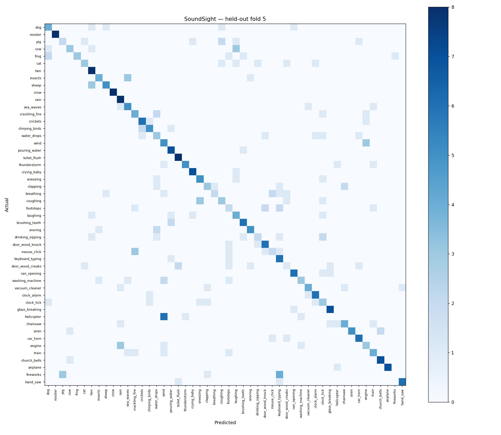

# First measured baseline

This result comes from an actual local training run on all 2,000 ESC-50 clips, not synthetic tests or a proposed target.

| Held-out fold | Training clips | Excluded shared-source clips | Test clips | Accuracy | Macro F1 |
| --- | ---: | ---: | ---: | ---: | ---: |
| 1 | 1,600 | 0 | 400 | 56.75% | 0.5589 |
| 2 | 1,598 | 2 | 400 | 58.50% | 0.5671 |
| 3 | 1,598 | 2 | 400 | 54.00% | 0.5281 |
| 4 | 1,597 | 3 | 400 | 61.25% | 0.6014 |
| 5 | 1,598 | 2 | 400 | 57.25% | 0.5576 |
| **Mean** | — | — | **2,000 unique total** | **57.55%** | **0.5626** |

Accuracy standard deviation across the five folds: **2.36 percentage points**, not a confidence interval. Hyperparameters were fixed before this evaluation. No pretrained model, augmentation, or tuning was used.

The supplied test folds are retained. Four source IDs in the upstream metadata cross folds under different labels; training clips sharing any source ID with the current test fold are excluded. Therefore this result is not an exact replication of the standard ESC-50 official-fold protocol. See `artifacts/metrics.json` for exact exclusions, content hashes, package versions, per-class scores and confusion matrices. `artifacts/predictions.json` contains every held-out prediction.

The saved demo model uses folds 1–4, with two shared-source clips removed, and is evaluated on fold 5. It is a real fitted RBF SVM with a fitted training-only scaler. Its score values are ranking scores rather than probabilities.

The fold-5 confusion matrix shows clear weaknesses: helicopter sounds are often classified as wind; footsteps, mouse clicks, wood creaks, and drinking/sipping also have low recall. These are useful starting points for error analysis rather than evidence of reliable real-world recognition.

Validation: **15 tests passed**, covering simulated microphone inference, sample analysis and chart rendering, MP3/FLAC/OGG/AIFF decoding, audio preprocessing, invalid input, official-fold splitting, source isolation, fitted-scaler isolation, model serialization/inference and Streamlit startup with the trained model. A held-out pig recording was also decoded and predicted successfully with the saved ESC-50 model. The software tests do not contribute to the reported accuracy.

To reproduce, follow the README with the pinned dataset revision and resolved environment. Future improvements should reserve an inner validation split for selecting features or model settings; repeated tuning against these reported outer folds would weaken the evaluation.
